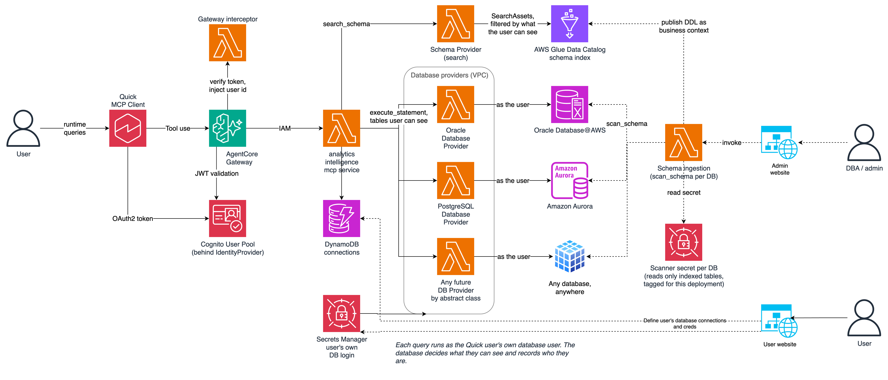

# One MCP server. Two tools. All your connected data served securely.

One MCP service, behind Amazon Bedrock AgentCore Gateway, that lets an agent search the schemas of every data source a user has connected and run statements against them as that user. The sample includes providers for Oracle (including Oracle Database@AWS), PostgreSQL and MySQL (Aurora or RDS), MariaDB, and Amazon Redshift. The sample documents Amazon Quick as the MCP client. API tools are also supported: ingest the schemas of your desired APIs and your users' agents can work with them, securely using the users' credentials (agents never see credentials or manage connections).



## How it works

- **Tools.** The agent gets two data tools for every database, however many are connected:
  - `search_schema`: semantic search over a schema index in AWS Glue Data Catalog. Returns `CREATE TABLE` DDL with keys, constraints, and comments for the relevant tables the user's own login can see, each tagged with its database, plus SQL guidance for that engine.
  - `execute_statement`: runs one statement against a named database as the user's own login, in a read-only transaction, with the statement timeout and row cap an administrator sets for that database when creating its connection on the admin page.
  - `web_search` (off unless `ENABLE_WEB_SEARCH=true` in `deploy.env`) returns grounded web answers with their sources. It sends a query the agent writes from the conversation to a web search outside your VPC, so it is left out unless you turn it on.
- **Identity.** Quick users sign in through Amazon Cognito. The gateway validates the token, and an interceptor writes the verified user ID into every tool call. Auth provider abstract class available for adding new OAuth providers. Contributions encouraged. See [CONTRIBUTING.md](CONTRIBUTING.md) for more info.
- **The database is the authority.** Each user registers their own database login. Each call reads it through one IAM role that is limited, by a `userId` session tag, to that user's secrets. The database decides what each user sees and logs who ran each query.
- **A connection is a login to one version of a registered database, nothing more.** It keeps the user's username and password and which version an administrator registered. A version's location (host, port, service) and how to reach it (TLS, a pinned certificate) never change, so a user's password only goes where the user entered it for. To move a database or change how it is reached, an administrator publishes a new version; users connect to it with their own login, and stay on the version they have until the administrator disables it. Disabling a version deletes every login users saved for it. Each version records which administrator created it, changed its settings, or disabled it.
- **Schema index.** An administrator registers each database with a scanner login. Each engine's database provider registers with the schema service on an EventBridge bus when it deploys. The schema service asks the provider for the database's engine to scan, and publishes what comes back as one Glue table per database table, with the DDL as its business context. Neither service imports the other's code. Scans run on demand or on an EventBridge Scheduler schedule.

## Prerequisites

- An AWS account and credentials that can deploy AWS CDK stacks, with the target account and Region bootstrapped for CDK (`cdk bootstrap aws://<account>/<region>`)
- AWS CLI v2
- Amazon Bedrock access, in the target Region, to Amazon Nova 2 Lite if you turn on `web_search`, and, with chat deployed, to the models the Chat page offers (`CHAT_MODELS` in `backend/cdk_infra/agent_provider/chat_models.py`, the only models the chat route accepts and the agent may invoke). `web_search` calls the US cross-Region inference profile `us.amazon.nova-2-lite-v1:0` (`WEB_SEARCH_MODEL_ID` in `backend/app.py`), so it works only from a US Region.
- A VPC with private subnets that can reach your databases. The VPC needs gateway endpoints for DynamoDB and S3. The stack checks the VPC for each interface endpoint its functions need (listed in `backend/cdk_infra/network/vpc_endpoints_stack.py`): it reuses one that exists, creates one that doesn't, tagged `createdby=Adam<Stage>`, and stops the deploy, naming the endpoint, if an existing one can't serve (private DNS off, failed, or duplicated). Use a separate VPC for each stage: a stage that reuses another stage's endpoints loses them when that stage is deleted.
- Python 3.11 or later, Node.js and npm, the AWS CDK CLI, Docker, Finch, or a similar container runtime (set `CDK_DOCKER` if it isn't `docker`), and [uv](https://docs.astral.sh/uv/)
- An Amazon Quick subscription with permission to add an MCP integration

## Deploy

```bash
cp deploy.env.example deploy.env   # profile, Region, VPC, security group, subnets
./install_cdk.sh                   # backend, then frontend
```

`install_cdk.sh` asks for any value `deploy.env` is missing and saves it. The stack creates no VPC and no database.

| Flag | Effect |
|---|---|
| `-b` | Backend stacks only |
| `-f` | Frontend only (needs an earlier backend deploy) |
| `-s <stage>` | Stage for this run, which names the stacks `Adam<Stage>-*` (default: `STAGE` at the top of `install_cdk.sh`, `dev`) |
| `-y` | No IAM approval prompts |
| `-h` | `cdk --hotswap-fallback`. Development only: it introduces drift. |
| `-n` | `cdk --no-rollback` |
| `-v` | `cdk --verbose` |

Self sign-up is off. Create users in the Cognito user pool, and add administrators to its `admin` group.

### Stages

The stacks are named `Adam<Stage>-*`, where `<Stage>` is the stage as given with its first letter capitalised (`dev` names `AdamDev`). `prod` is the only stage that behaves differently (`backend/cdk_infra/shared/stage.py`):

- `prod` turns on point-in-time recovery and deletion protection on the tables that hold users' data, and deletion protection on the user pool. It keeps those tables, the user pool, and the log groups when a stack is deleted, keeps logs for a year, and accepts no sign-in from localhost.
- Any other stage keeps logs for a month, deletes its tables, user pool, and log groups with its stacks, and also accepts sign-in callbacks to `http://localhost:5173/`, for a frontend dev server on your machine.

## Connect Amazon Quick

Add the service to Amazon Quick as an MCP integration, using the stack outputs. The fields, how to
read the client secret, how each user signs in, and what to check when something fails are in
[clients/amazon-quick](clients/amazon-quick/README.md).

## Database accounts

The admin page shows the same guidance for each engine. It comes from each provider's `ADMIN_BEST_PRACTICES`.

### User accounts

Create one account per person or role, with only the grants that person should have. Don't register a schema owner, a superuser, or any account with `ANY` or `CREATE` privileges. Registering a connection checks only that the login works, so these practices are the DBA's to apply.

Oracle:

```sql
CREATE USER analyst IDENTIFIED BY "<password>";
GRANT CREATE SESSION TO analyst;
GRANT READ ON app.accounts TO analyst;           -- each table or view this person may see
-- No EXECUTE on definer's-rights code (AUTHID DEFINER, the default), including through PUBLIC:
-- it runs with its owner's privileges, so it can write whatever this account's grants are.
-- Oracle AI Database 26ai (release 23.26) and later: block DDL as well as DML.
ALTER USER analyst READ ONLY;
```

Every statement already runs in a read-only transaction, which blocks DML but not DDL. On releases before 23.26, block DDL with a trigger, created by an administrator:

```sql
CREATE OR REPLACE TRIGGER agent_accounts_no_ddl
BEFORE DDL ON DATABASE
BEGIN
  IF ora_login_user IN ('ANALYST', 'SCANNER') THEN
    RAISE_APPLICATION_ERROR(-20001, 'DDL is not allowed for this account.');
  END IF;
END;
/
```

PostgreSQL (the read-only transaction blocks DML and DDL):

```sql
CREATE ROLE analyst LOGIN PASSWORD '<password>';
GRANT CONNECT ON DATABASE appdb TO analyst;
GRANT USAGE ON SCHEMA app TO analyst;
GRANT SELECT ON app.accounts TO analyst;         -- each table or view this person may see
```

MySQL and MariaDB (the read-only transaction blocks DML and DDL). A connection is one database; only its tables are listed. A role's grants apply only once it is the account's default role:

```sql
CREATE USER 'analyst' IDENTIFIED BY '<password>';
GRANT SELECT ON appdb.accounts TO 'analyst';     -- each table or view this person may see
```

Amazon Redshift (the read-only transaction and cursor block DML and DDL):

```sql
CREATE USER analyst PASSWORD '<password>';
GRANT USAGE ON SCHEMA app TO analyst;
GRANT SELECT ON app.accounts TO analyst;         -- each table or view this person may see
```

### Scanner accounts (minimum permissions)

One per database. The scan lists objects the account holds a privilege on. `REFERENCES` is enough: it shows an object's columns, keys, and comments, and doesn't allow queries on its rows.

Oracle:

```sql
CREATE USER scanner IDENTIFIED BY "<password>";
GRANT CREATE SESSION TO scanner;
GRANT REFERENCES ON app.accounts TO scanner;     -- each table or view to index
ALTER USER scanner READ ONLY;                    -- 26ai and later; otherwise add it to the trigger above
```

Constraints and comments come from the `ALL_*` dictionary views. A query on the table fails with `ORA-41900`.

PostgreSQL:

```sql
CREATE ROLE scanner LOGIN PASSWORD '<password>';
GRANT CONNECT ON DATABASE appdb TO scanner;
GRANT USAGE ON SCHEMA app TO scanner;
GRANT REFERENCES ON app.accounts TO scanner;     -- each table or view to index
```

Keys, constraints, and comments come from `pg_catalog`, which any role can read. A query on the table fails with `permission denied`.

MySQL and MariaDB show a view's definition only to an account that can also query it, so views need more than `REFERENCES`:

```sql
CREATE USER 'scanner' IDENTIFIED BY '<password>';
GRANT REFERENCES ON appdb.accounts TO 'scanner';             -- each table to index
GRANT SHOW VIEW, SELECT ON appdb.v_accounts TO 'scanner';    -- each view to index
```

Amazon Redshift:

```sql
CREATE USER scanner PASSWORD '<password>';
GRANT USAGE ON SCHEMA app TO scanner;
GRANT REFERENCES ON app.accounts TO scanner;     -- each table to index
GRANT SELECT ON app.v_accounts TO scanner;       -- each view to index
```

Register the scanner on the admin page in one of two ways:

- **Username and password.** The engine's scanner stores them as a new secret under `/Adam<Stage>/scanners/`.
- **An existing secret.** Create it under that path, which the admin page shows. The scanners may read no secret outside it, and the user-facing providers can't read any secret under it. If the secret uses a customer managed AWS KMS key, grant `kms:Decrypt` to the scanner role the admin page names when it is refused.

Connections to PostgreSQL, MySQL, MariaDB and Redshift always use TLS, with the server's certificate and hostname verified. Oracle offers TLS (TCPS) only if its listener is configured for it, often on port 2484. When you save an Oracle database, its scanner login is tried over TLS first. If that works, every connection to that database uses TLS. If it doesn't, the database is saved without TLS and the admin page warns you why, until you publish a new version at a TLS port. A login the database refuses over TLS is not retried without it. When the database's certificate is its own (self-signed, as Oracle Database@AWS's TCPS listener presents) or from a CA the service doesn't carry, the save trusts the certificate the database presents, keeps it with the database, and shows its SHA-256 fingerprint on the admin page; check it against the certificate on the database. Every connection to it then trusts that certificate and no other. A scan never changes that: if the database later presents a different certificate, or different TLS, the scan is refused and nothing changes; publish a new version if you trust what it presents.

## Add a data source engine

1. Subclass `DataSourceProvider` (`backend/src/adam/data_source_provider/data_source_provider.py`). Implement `scan_schema`, `execute_statement`, `visible_objects` and `probe`, and set `STATEMENT_BEST_PRACTICES` and `ADMIN_BEST_PRACTICES`.
2. Add the engine to `_ENGINE_PROVIDERS` in `engines.py`, to `ENGINES` in `backend/cdk_infra/shared/data_source_engines.py` (its driver and files; this gives it a provider function and a scanner that registers with the schema service when the stack deploys), and its SSM key to `ENGINE_PROVIDER_SSM` in `backend/src/adam/shared/provider_client.py`. A unit test checks the three agree.

The MCP tools, connection registration, scanning, and visibility filtering don't change.

## Chat in the web console

Quick is the agent in the default deployment: it calls the Gateway's MCP tools directly, so no agent
runs in your account. The website can also have a Chat page, answered by an agent on Amazon Bedrock
AgentCore Runtime that calls the same tools as the signed-in user. Its code is in
`backend/src/adam/agent_provider/agent_runtime/` (the agent, its requirements, and a
Dockerfile that holds nothing else). It is deployed by default; set `ENABLE_CHAT=false` in `deploy.env`
to leave it out. It adds:

- the runtime, built from that Dockerfile (needs Finch or Docker);
- interface endpoints for `ecr.api`, `ecr.dkr` and `logs`, if the VPC lacks them: the runtime pulls
  its image and ships its logs from inside the VPC. Its subnets must be in AgentCore's supported
  Availability Zones (in us-east-1, `use1-az1`, `use1-az2`, `use1-az4`);
- the Chat page, with a model picker and each user's own conversation history.

Without it, `/api/chat` answers that chat is not enabled, and the website has no Chat page.

## Services and cost

| Service | Used for | Cost driver |
|---|---|---|
| Amazon VPC interface endpoints | One per service in `vpc_endpoints_stack.py` the VPC doesn't already have, in each subnet's zone | Fixed: hourly per endpoint per zone, plus data processed. The largest fixed cost. |
| AWS Secrets Manager | User and scanner logins | Per secret per month, plus API calls |
| Amazon Bedrock AgentCore Gateway | MCP endpoint | Per tool call |
| Amazon Bedrock AgentCore Runtime | Agent for the web console's chat (on by default; `ENABLE_CHAT=false` leaves it out) | Usage-based; see the pricing page |
| Amazon ECR | The chat agent's container image, in the CDK bootstrap repository | Storage |
| AWS AppSync Events | Streams chat replies to the website | Per operation and per connection minute |
| AWS Lambda | All functions | Per request and duration |
| Amazon DynamoDB (on-demand) | Connections, scan targets, and registered providers | Per request and storage |
| AWS Glue Data Catalog | Schema index and semantic search | Objects stored and requests |
| Amazon Bedrock | The chat models, and `web_search` (Amazon Nova 2 Lite with web grounding) when turned on | Per token; see the pricing page for web grounding |
| Amazon Cognito | Users | Monthly active users |
| Amazon API Gateway | Websites' API | Per request |
| Amazon S3 and Amazon CloudFront | Websites, and scan results (kept 7 days) | Storage and transfer |
| Amazon EventBridge | Scan requests and results (a custom bus); scheduled scans (Scheduler) | Per event; per invocation |
| Amazon CloudWatch Logs | Logs of every function and the gateway (kept a month, or a year in `prod`), and of the agent runtime, under `/aws/bedrock-agentcore/runtimes/` | Ingestion and storage |
| AWS X-Ray | The chat agent's traces | Per trace recorded and retrieved |
| Amazon Redshift Serverless (optional) | `REDSHIFT_TEST_TARGET=true`: a 4 RPU workgroup for the Redshift provider's tests | Compute while queries run, and storage |

See each service's pricing page for current rates in your Region.

## Remove a deployment

Delete the stacks in this order: each later stack provides resources to the ones before it, and the functions reach AWS services through the endpoints in `-VpcEndpoints`. `RedshiftTestTarget` exists only if it was deployed, and `VpcEndpoints` only if the deploy created endpoints; deleting a stack that doesn't exist does nothing. `cdk destroy` would synthesize each app first, which needs the network values and, for the website, a UI build, so this uses CloudFormation directly:

```bash
prefix=Adam<Stage>
for s in Frontend Agent RedshiftTestTarget DataSourceProviders GlueCatalog Auth VpcEndpoints; do
  aws cloudformation delete-stack --stack-name "$prefix-$s" --profile <profile> --region <region>
  aws cloudformation wait stack-delete-complete --stack-name "$prefix-$s" --profile <profile> --region <region>
done
```

What the stacks don't delete:

- **Connection and scanner secrets.** The service creates them at run time, under `/Adam<Stage>/connections/` and `/Adam<Stage>/scanners/`, so they are not part of any stack. Removing a connection, disabling a database version, or replacing a scanner login entered on the admin page, deletes its secrets; any left after teardown must be deleted in Secrets Manager. Secrets an administrator created and registered are theirs to delete.
- **The chat agent's image**, in the CDK bootstrap ECR repository, and the runtime's log groups under `/aws/bedrock-agentcore/runtimes/`, which the runtime creates itself.
- **In `prod`**, the tables that hold users' data, the user pool, and the log groups. To delete the tables and the user pool, turn off their deletion protection first.

## Tests

```bash
# install_cdk.sh creates .venv with uv; add the test requirements to it, from the repository root.
uv pip install --python .venv -r backend/requirements-dev.txt
cd backend/src
../../.venv/bin/python -m pytest tests/unit -q
# Admin passwords for the test containers, generated into the git-ignored .env.test
# (none is written in the repository). The containers and the tests both read it.
for k in ORACLE_PASSWORD POSTGRES_PASSWORD MYSQL_ROOT_PASSWORD MARIADB_ROOT_PASSWORD; do
  echo "$k=Aa1$(openssl rand -hex 12)"; done > ../../.env.test
docker compose -f ../../docker-compose.test.yml up -d   # Oracle, PostgreSQL, MySQL, MariaDB, DynamoDB Local, moto; on 127.0.0.1 only
../../.venv/bin/python -m pytest tests/integration -q -m integration
```

Redshift has no local container, and its provider verifies the server's hostname over TLS, so its tests (`backend/src/tests/deployed`) run through the deployed provider function. Deploy with `REDSHIFT_TEST_TARGET=true` in `deploy.env` (a private Redshift Serverless workgroup at 4 RPU, billed only while queries run), then:

```bash
TEST_DEPLOYED_PREFIX=Adam<Stage> AWS_PROFILE=<profile> \
  ../../.venv/bin/python -m pytest tests/deployed -m deployed
```

## Lint and security scan

`.pre-commit-config.yaml` runs ruff and ESLint on commit, and [Automated Security Helper](https://github.com/awslabs/automated-security-helper) (ASH) on push. ASH's configuration and its suppressions, each with a reason, are in `.ash/.ash.yaml`.

```bash
pre-commit install --hook-type pre-commit --hook-type pre-push
pre-commit run --all-files                          # ruff, ESLint
pre-commit run ash-simple-scan --all-files --hook-stage pre-push
```

## Sample dataset

`backend/demo_dataset` generates a synthetic dataset of fictional banking (Oracle) and wealth-management (PostgreSQL) data. The service itself has no knowledge of it.

Before loading, a DBA creates:

- Oracle: the schema owner `MCP_DEV`, and the user accounts `RELATIONSHIP_MANAGER` and `SERVICING_ANALYST`
- PostgreSQL: the role `mcp_dev`, which owns schema `wealth`, and the roles `relationship_manager` and `servicing_analyst`

The loader creates the tables, views, and grants to those accounts. With `--apply` it drops and recreates the dataset's objects; without it, it only generates and checks the data. Run it from a machine that can reach both databases:

```bash
cd backend
../.venv/bin/python -m demo_dataset.build \
    --profile <profile> --region <region> \
    --oracle-secret-arn <MCP_DEV secret> --oracle-admin-secret-arn <admin secret> \
    --oracle-dsn <host:port/service> \
    --aurora-secret-arn <mcp_dev secret> --aurora-host <host> --aurora-port 5432 \
    --aurora-database <database> --apply
```

The admin secret is needed only if `MCP_DEV` is `READ ONLY`: the loader lifts it for the write and restores it. Then register both databases on the admin page and scan them. Give each persona its own website user: register `RELATIONSHIP_MANAGER`/`relationship_manager` as one user's connections, and `SERVICING_ANALYST`/`servicing_analyst` as another's. Asking both the same question shows each database applying its own grants.

## Security

See [CONTRIBUTING](CONTRIBUTING.md#security-issue-notifications) for more information.

## License

This project is licensed under the Apache-2.0 License. See the [LICENSE](LICENSE) file.
